# 灵光一挂 · FadeLine

<p align="center">
  <a href="https://github.com/ZiOstudio/FadeLine/stargazers"></a>
  <a href="https://github.com/ZiOstudio/FadeLine/stargazers"></a>
</p>

> **把想法挂到绳子上：位置就那么多，挂满了最旧的就得让路。别的工具帮你记住，它帮你忘记。**

<p align="center">
  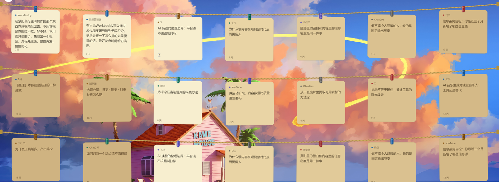
</p>

<p align="center">
  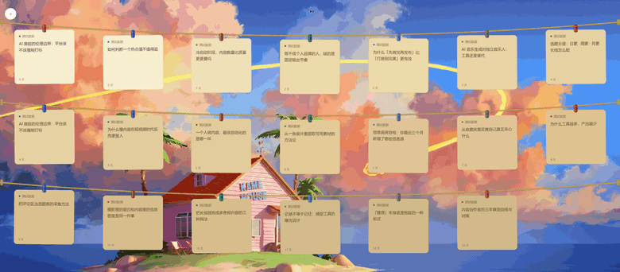
</p>

<p align="center"><sub>悬停到哪根绳，哪根就亮起来 ｜ 点一下卡片就地改 ｜ <kbd>Ctrl</kbd>+<kbd>Alt</kbd>+<kbd>Q</kbd> 随时收起 / 放出</sub></p>

<p align="center">
  
  
  
  
  
</p>

---

## 它解决什么

真正的问题不是「记不住」，是**「记了一堆却从来不做」**。

|  | 收藏夹 / 笔记软件 | 待办清单 | **灵光一挂** |
| --- | --- | --- | --- |
| 接住想法 | ✅ | ✅ | ✅ |
| 帮你做取舍 | ❌ 只堆积 | ⚠️ 靠自律 | **✅ 容量有限，满了就得决定** |
| 会不会催你 | ❌ 不催（于是被遗忘） | ⚠️ 会焦虑 | **✅ 不催，但会替你淘汰** |

你看收藏夹里那些「稍后再读」——它们的问题从来不是没被记下来，而是**没有任何机制逼你面对它们**。

灵光一挂的做法很土：**绳上就那么多位置**。屏幕大，绳子多挂几张；屏幕小，就少挂几张——但总归有限。挂满了，新的进来，最旧的就得走。你必须在有限的空间里做取舍，而取舍本身就是在想清楚自己到底要做什么。

---

## 下载即用

到 [Releases](../../releases/latest) 下载 **`FadeLine-x.y.z-portable.zip`**，**解压后双击里面的 `灵光一挂.exe`**。

**不需要提前装任何东西** —— 不用 Node、不用 Python。**只支持 Windows 10 / 11。**

压缩包约 100 MB（解压后约 230 MB，里面装着整个 Electron 运行时，这是它的代价）。

**装一次就常驻：** 首次启动会在 Windows 的启动文件夹里放一个指向自己的快捷方式，以后开机自动把绳子挂好 —— **你不用每次自己打开它**。不想要常驻：右键托盘图标 → 关掉开机自启，或者删掉启动文件夹里的「灵光一挂」快捷方式。

> 第一次运行时 Windows 可能弹「Windows 已保护你的电脑」，点 **「更多信息」→「仍要运行」**。
> 原因是这个 exe 没有买代码签名证书（一年几千块），**不是它有问题**。

> **为什么发的是压缩包，不是单个 exe？** 单个 exe 得用 electron-builder 打包，那是一整条几百 MB 的工具链；
> 压缩包版本纯手工组装就行，不需要额外装任何东西 —— 代价是解压后文件多、体积略大。
> 想要单文件版的话 `npm run build` 可以出（见文末「开发」）。

## 从源码运行

**环境要求**：Windows 10 / 11 + [Node.js](https://nodejs.org) 18 或更高

1. clone 本仓库
2. 双击根目录的 **`启动.bat`**（首次运行会自动装依赖，约 100 MB，之后不再需要）
3. 鼠标推到**屏幕最顶端**停一下 —— 绳子就下来了

数据默认放在 `你的文档\灵光一挂\`，**不需要任何配置**。想换地方改 `config.json` 里的 `vault`（位置见文末「配置文件在哪」）。

源码模式同样会写开机自启的快捷方式（默认开），不想要就右键托盘图标关掉 —— 免得开机时平白拉起一个 Electron 开发实例。

---

## 怎么用

| 操作 | 效果 |
| --- | --- |
| <kbd>Ctrl</kbd>+<kbd>Alt</kbd>+<kbd>Q</kbd> | 唤出 / 收起绳子 |
| 鼠标推到屏幕顶端停 0.4 秒 | 同上（热键被占用时的备用路径） |
| 左键单击托盘图标 | 同上 |
| 右键托盘图标 | 开关开机自启（**默认已开**）、立即备份一次、打开数据目录、退出 |
| 点左上角的 **+** | 记一条。**来源会自动填好**（你在哪个应用里看到的东西） |
| **轻点**卡片 | 就地编辑（改文案、换来源） |
| **按住往下拖**到收藏夹 | 采用，移进 `02-采用` |
| 编辑窗底部四个按钮 | 丢掉 / 取消 / 保存 / 采用 |
| 移动后 10 秒内点提示上的「撤销」 | 反悔 |

---

## 效果预览

九张状态图，全是 2560×1440 下的全屏实拍（同一批演示数据，桌面杂物已去掉）。图上那段说明，就是拿去发朋友圈用的那套。点标题展开。

<details>
<summary><b>展开：九种状态一览</b></summary>
<br>

<p align="center">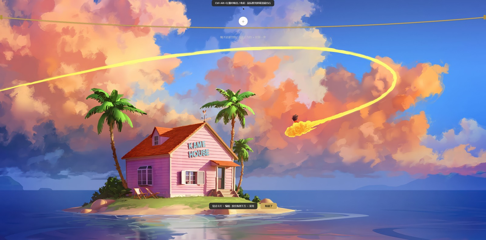<br><sub>刚打开：绳子空着，点正上方的 <b>+</b> 挂第一条</sub></p>

<p align="center">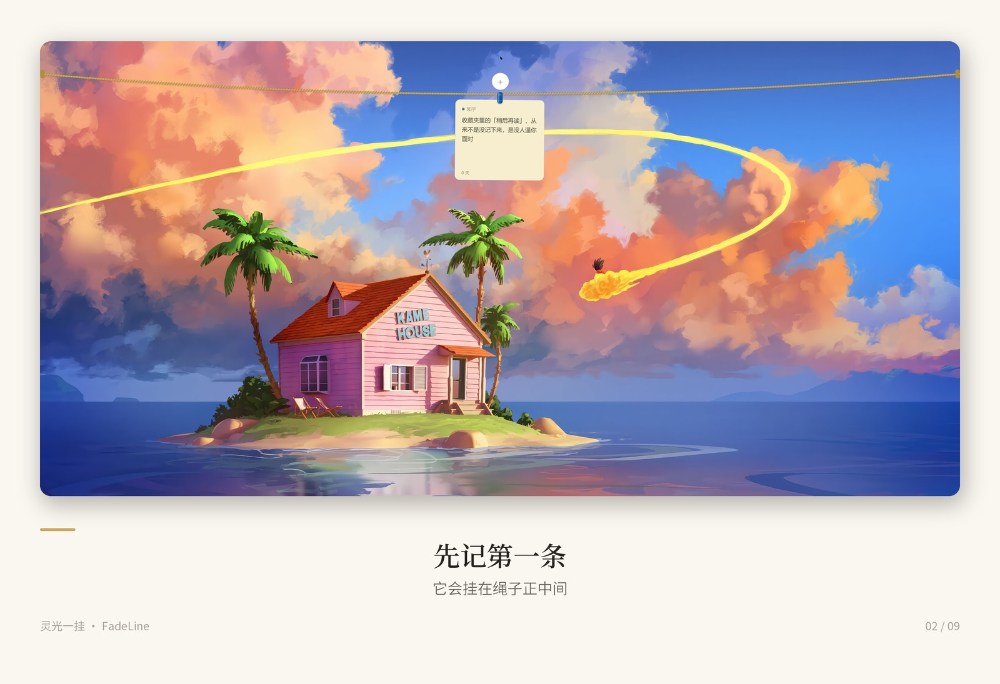<br><sub>第一条灵感：挂在绳子正中间</sub></p>

<p align="center">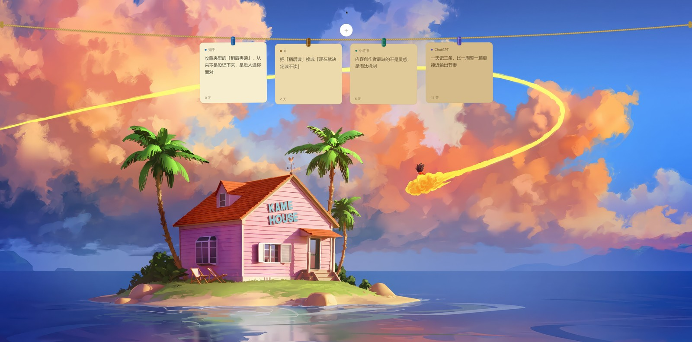<br><sub>没挂满时整组居中，卡片颜色随年龄从浅黄油走到陈年琥珀</sub></p>

<p align="center">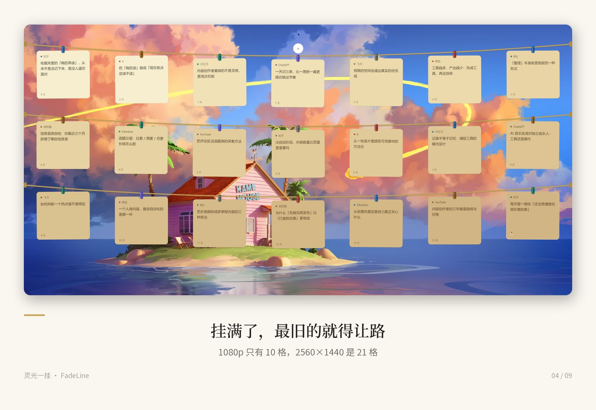<br><sub>挂满三根绳：1080p 是 10 格，2560×1440 是 21 格</sub></p>

<p align="center">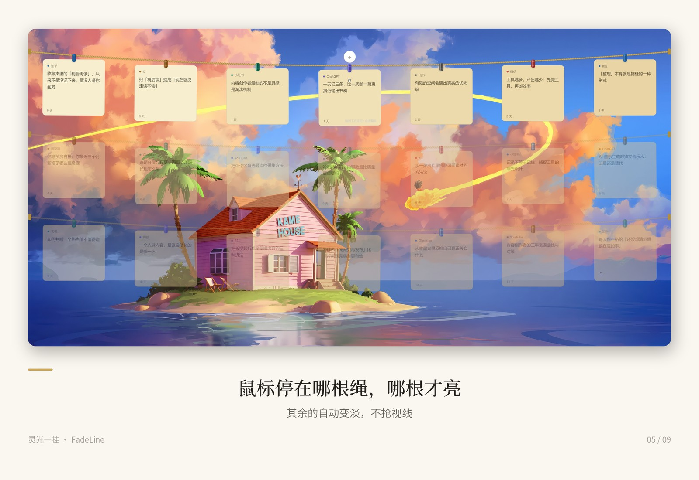<br><sub>鼠标停在哪根绳，哪根才亮，其余自动变淡</sub></p>

<p align="center">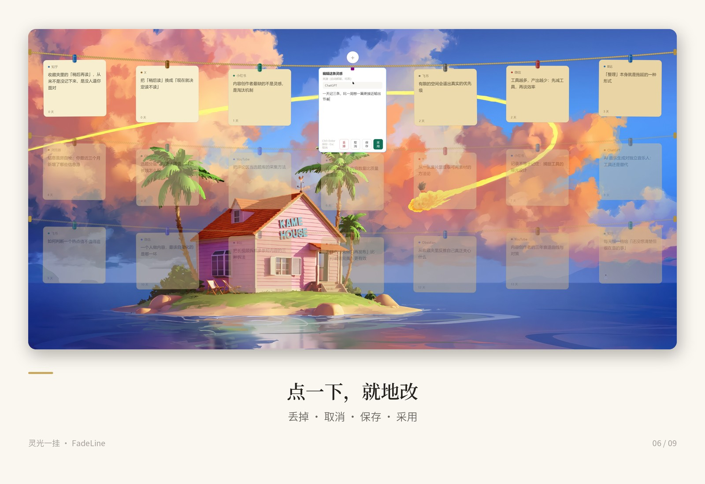<br><sub>轻点卡片就地改：丢掉 / 取消 / 保存 / 采用</sub></p>

<p align="center">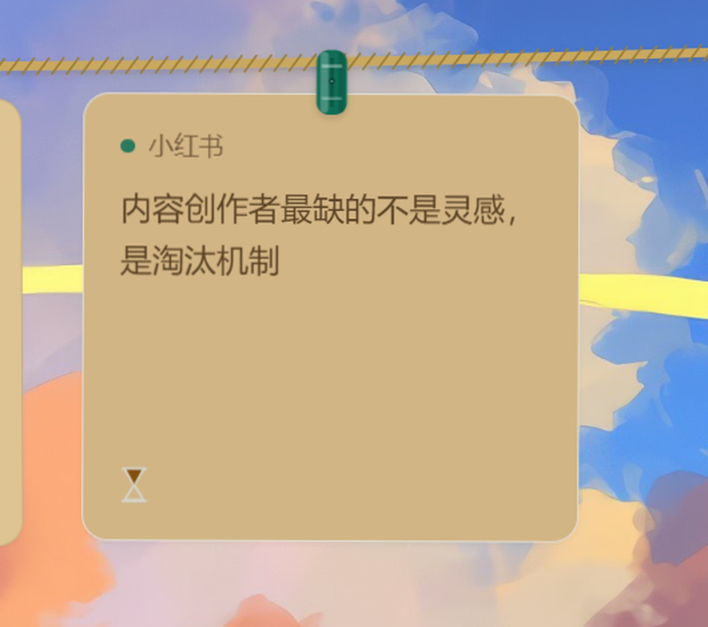<br><sub>挂太久没动的会被标上沙漏，48 小时内碰一下还能救回来</sub></p>

<p align="center">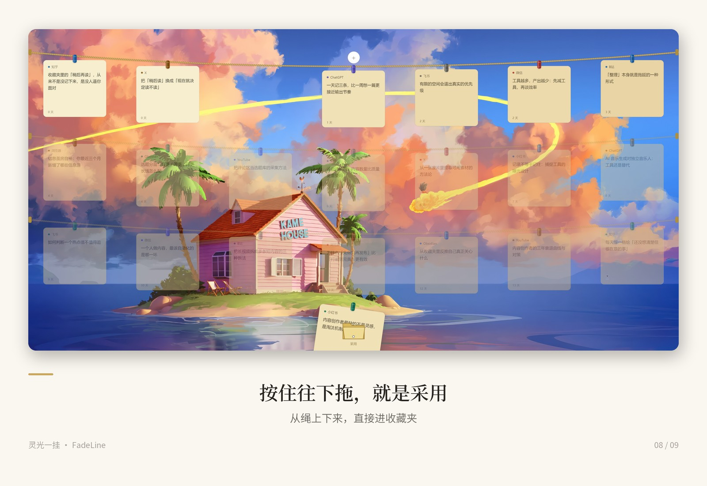<br><sub>按住往下拖到收纳位＝采用，它就从绳上下来</sub></p>

<p align="center">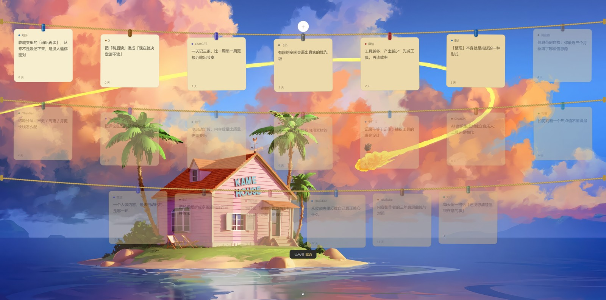<br><sub>移动之后 10 秒内可以撤销，手滑不怕</sub></p>

</details>

---

## 工作原理

数据就是一堆 Markdown 文件，**没有数据库、没有私有格式**。每个条目都能单独打开、单独发送、单独备份。

```
你的文档\灵光一挂\
├── 01-在杆\      当前挂在绳子上的
├── 02-采用\      你认可、要拿去用的
├── 03-搁置\      被挤出去 / 超时 / 挂太久的（系统替你决定）
├── 04-垃圾桶\    你主动丢掉的
└── _规则.md      这份说明的详细版
```

**一条硬规则：文件夹位置优先于文件里的任何字段。** 你用资源管理器把文件从 `01` 拖到 `02`，它就等于被采用了。**你完全可以不用这个程序，只用文件管理器管理它。**

### 淘汰规则

容量 = 每行张数 × 绳数，两个数都由屏幕尺寸决定：
2560×1440 上是 7 × 3 = 21 格，最常见的 1920×1080 上是 5 × 2 = 10 格，笔记本上可能只有 5 格。

1. **挂满了** → 最旧的被挤出去，进 `03-搁置`
2. **满的时候** → 最旧那张被标上「待淘汰」，卡片上出现沙漏
3. **待淘汰的那张**：
   - 你碰它一下（编辑 / 拖走）→ 标记取消
   - 挂满 **48 小时**没动 → 进 `03-搁置`
   - **这 48 小时里它受保护**：新卡进来挤掉的是次旧的，不会顶掉它
4. **挂满 14 天** → 进 `03-搁置`（颜色也走到最深，正好对应「即将离开」）

卡片颜色随时间**由浅黄油褪到陈年琥珀**——颜色最深的那张，就是最该处理的那张。

---

## 配置

程序**首次运行会自动生成** `config.json`。

**配置文件在哪？**

| 你怎么用的 | 路径 |
| --- | --- |
| 下载的 exe | `%APPDATA%\灵光一挂\config.json` |
| 从源码运行 | `overlay\config.json` |

（从源码跑时也可以用 `overlay/config.example.json` 作格式参考。）

常改的几项：

| 键 | 说明 |
| --- | --- |
| `hotkey` | 主热键。被别的程序占用就换一个 |
| `vault` | 数据目录。**移动或改名后一定要改这里**，否则绳子会是空的 |
| `pythonPath` | 通常不用填 —— 来源识别和全屏检测走内置原生模块。只有它加载失败时才需要回退 Python |
| `autoStart` | 开机自启，**默认开**（会在启动文件夹放快捷方式）。托盘菜单里也可以随时关 |
| `gameProcesses` | 自动识别不到的游戏填这里兜底 —— 写进程名，**不带 `.exe`**、不区分大小写。全屏游戏通常已经能自动识别 |
| `sourceNames` / `siteNames` | 来源识别的映射表，**会和内置表合并，只写你想加或想改的** |

### 备份

程序每 6 小时自动把整个灵感箱快照到数据目录旁边，保留最近 28 份（约 7 天）。托盘菜单里有「立即备份一次」。

---

## 已知限制

老实列一下，免得你踩到：

- **不接管截图** —— 它管的是「想法」。系统截图（<kbd>Win</kbd>+<kbd>Shift</kbd>+<kbd>S</kbd>）还是原样落在你的图片文件夹
- **来源识别有天花板** —— 桌面客户端拿不到网页标题（操作系统限制），只能到应用名。用 `siteNames` 可以按窗口标题关键词补
- **全屏检测有盲区** —— 窗口化 / 无边框窗口运行的游戏（系统不报全屏状态）检测不到，要靠 `gameProcesses` 名单。反过来说，全屏看视频或全屏演示时也会自动收起浮层、暂时注销热键。另外它靠轮询（收起时每 0.8 秒一次），所以**游戏刚切进全屏的一瞬间**推顶边理论上还有极小概率唤出；真遇到的话，把游戏进程名写进 `gameProcesses` 就是硬判定，不走轮询
- **只支持主显示器**
- **程序内没有搜索** —— 需要搜索时建议把数据目录放进 [Obsidian](https://obsidian.md) 之类的知识库，用它们的全文搜索（数据本来就是 Markdown，天然兼容）
- **热键可能被第三方键盘钩子吞掉** —— 某些安全软件 / 输入法会拦截全局热键。换一个组合即可
- **exe 没有代码签名** —— 首次运行会有系统提示，见上面「下载即用」一节
- **默认会开机自启** —— 这是故意的：它靠常驻才能随手唤出。不想常驻就右键托盘图标关掉；删掉启动文件夹里的「灵光一挂」快捷方式效果一样
- **挪动了程序文件夹要重开一次** —— 自启快捷方式记的是绝对路径。把「灵光一挂」文件夹移动 / 改名之后，重新打开一次程序就会自动修正（启动时会自检并补建）
- **绿色版没有卸载程序** —— 删文件夹之前，先从托盘菜单关掉开机自启（否则启动文件夹里会留一个指向空地址的快捷方式）

上面这些你踩到了，或者遇到了别的毛病？[开个 issue](../../issues/new/choose) —— 有模板，几条就够，不用写漂亮。

---

## 发新版（维护者看）

1. 改代码，`overlay/package.json` 里的 `version` 加一档（比如 `0.1.0` → `0.1.1`）
2. 双击 **`打包.bat`**，等它跑完
3. 到 GitHub 仓库的 **Releases** 页 → **Draft a new release**
   - Tag 填 `v0.1.1`（**要和上面的 version 一致**）
   - 标题写这次改了什么
   - 把 `dist\FadeLine-0.1.1-portable.zip` 拖到附件区
     （**文件名必须是纯英文** —— GitHub 会把附件名里的中文直接剥掉，
       `灵光一挂-0.1.1.zip` 会变成 `-0.1.1.zip`）
   - Publish

**为什么 exe 不上传到 git 仓库里？** exe 有几十 MB，而 git 会保存每一次历史 ——
发十个版本，仓库就永久变大几百 MB，以后别人 clone 要下半天，而其中大部分是旧版本。
Releases 是专门放成品的地方，不占仓库体积，下载链接还永久有效。

---

## 开发

```sh
cd overlay
npm install

npm start                      # 启动
npm test                       # 跑单元测试（数据层 + 布局，共 27 项）

node dev/test_store.js         # 数据层：增删移 + 淘汰规则
node dev/test_layout.js        # 布局几何 + 纸张褪色算法
node dev/seed20.js             # 造 20 条假数据看满屏效果（目录要先存在）

python dev/make_demo_gif.py    # 录一段演示动图到 docs/demo.gif（要 Pillow + ffmpeg）
```

`dev/` 里剩下的脚本（截图、造图标、模拟点击、录演示、来源探测方式对比）都是开发时的一次性工具，不影响程序运行。

打包：双击根目录的 **`打包.bat`** → `dist\FadeLine-x.y.z-portable.zip`（免安装压缩包，不需要额外工具）。
想要单个 exe：先 `npm install`（会装上 electron-builder）再 `npm run build` → `dist\FadeLine-x.y.z.exe`。

代码结构：

| 文件 | 职责 |
| --- | --- |
| `main.js` | Electron 主进程：窗口、热键、托盘、备份、自检 |
| `overlay.html` | 浮层界面：渲染、拖拽、悬停聚焦、首次引导、撤销 |
| `editor.html` | 就地编辑窗（独立窗口，这样才能收键盘） |
| `store.js` | 数据层，**唯一的写盘入口** |
| `layout.js` | 布局与褪色的纯函数，可在 Node 里直接单测 |
| `win32.js` | 用 koffi 直接调 Windows API（抓前台窗口 / 检测全屏）—— **不需要 Python** |
| `legacy-python/` | 上面那件事的 Python 旧版，只在原生模块加载失败时兜底（正常用不到，见该目录里的 README） |

设计上有三条跨文件契约，改代码前值得先读一下源码里的注释：

1. **`data-hot`** —— 浮层默认是点击穿透的，**任何可点击的 DOM 元素必须带 `data-hot`**，否则操作系统层面点不动
2. **`layout.js` 是尺寸的唯一来源** —— 主进程的 `computeCapacity()` 必须与它的公式保持一致
3. **文件夹位置优先** —— 不要依赖文件里的 `history` 字段推断它当前在哪

---

## Star

如果这个工具帮你少堆了一个收藏夹、多做成了一件事——点个 Star，让更多「记了一堆却从来不做」的人看到它。

它不需要你花钱，也不需要注册账号，就是让这个仓库在搜索和推荐里更容易被找到。

<p align="center">
  <a href="https://github.com/ZiOstudio/FadeLine/stargazers">
    
  </a>
</p>

## 致谢

**感谢 [@longhaiqwe123](https://x.com/longhaiqwe123)**——是他让我第一次看到把便签挂起来的做法。

视觉上的参考也来自他：他分享了 [Tendedero](https://github.com/alejandrobujan/tendedero)（macOS 上的同类工具，把截图挂在线上）这个仓库，让我能直接参考它的形式，构筑出我想要的东西。本项目的**微风摆动动画**和**夹子造型**就是从那里学来的。

## License

[MIT](LICENSE) · 代码随便用、随便改、拿去商用也行，不用打招呼。只有一件事：**fork 或二次分发时换个名字和图标**，别让人误以为是同一个东西 —— 留好仓库里的版权声明就够了。
